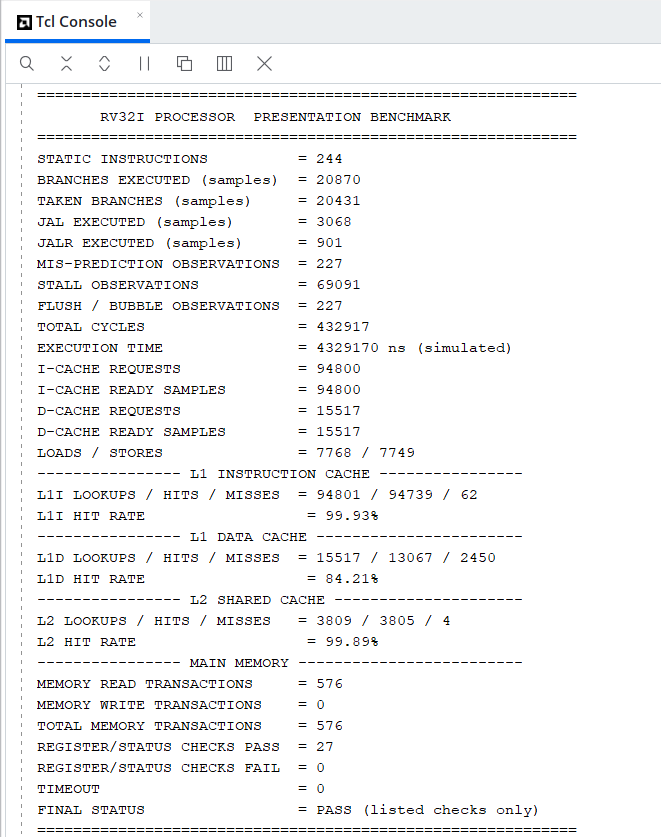
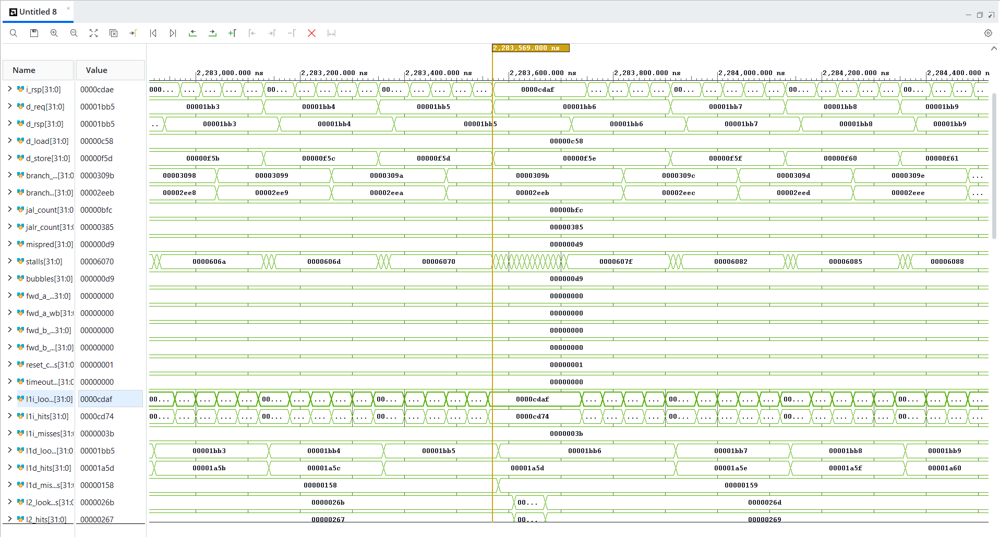

# RV32I Two-Level Cache Memory Hierarchy

A complete **SystemVerilog RTL** implementation of a **two-level cache hierarchy** (split L1 I/D caches + shared 4-way L2 + main-memory model) integrated into a **5-stage pipelined RV32I RISC-V core** with a **gshare branch predictor and BTB**. The design is verified with a self-monitoring testbench running a 244-instruction benchmark and simulated in Vivado.

On the included benchmark the hierarchy reaches a **99.93 % L1 I-cache hit rate**, **84.21 % L1 D-cache hit rate** and **99.89 % L2 hit rate**, so only **576 accesses** reach main memory out of roughly 110,000 L1 lookups.

> Part of a three-project RV32I series:
> 1. [`RV32I_RISC_V-5_STAGE_PIPELINE`](https://github.com/Guru-P169/RV32I_RISC_V-5_STAGE_PIPELINE): base 5-stage pipelined core
> 2. [`rv32i-gshare-branch-predictor`](https://github.com/Guru-P169/rv32i-gshare-branch-predictor): dynamic branch prediction
> 3. **`rv32i-cache-memory-hierarchy`** (this repo): L1 / L2 cache hierarchy integrated with both of the above

---

## Key Highlights

- Two-level hierarchy: **L1 I-cache + L1 D-cache → arbiter → shared L2 → main memory**
- **Direct-mapped L1 caches** with 16-byte lines and FSM-based controllers
- **Write-back, write-allocate L1 D-cache** with dirty bits and victim write-back
- Byte / halfword / word access with sign- and zero-extension (`LB`, `LH`, `LW`, `LBU`, `LHU`, `SB`, `SH`, `SW`)
- **4-way set-associative L2** (16 KB) with true **LRU replacement**
- **Round-robin arbiter** sharing the L2 between instruction and data misses
- Parameterised main-memory model with configurable latency (default 5 cycles) and hex preload
- Pipeline-wide stall on D-cache miss; cache-aware fetch buffer on the instruction side
- Integrated with a **gshare predictor (4-bit history) and 16-entry BTB**
- Testbench with cache hit/miss counters, hazard/branch statistics and 27 directed register checks, all passing

---

## Architecture


```
                  ┌──────────────────────────────────────────┐
                  │     RV32I 5-Stage Pipeline (rv32i_core)  │
                  │   IF ─► ID ─► EX ─► MEM ─► WB            │
                  │   gshare predictor + BTB                 │
                  └───────┬──────────────────────┬───────────┘
                    fetch │                      │ load / store
                          ▼                      ▼
                  ┌──────────────┐       ┌───────────────┐
                  │  L1 I-Cache  │       │  L1 D-Cache   │
                  │  1 KB, DM    │       │  write-back   │
                  └──────┬───────┘       └───────┬───────┘
                         └────────┬──────────────┘
                                  ▼
                        ┌───────────────────┐
                        │   L2 Arbiter      │  round-robin
                        └─────────┬─────────┘
                                  ▼
                        ┌───────────────────┐
                        │  Shared L2 Cache  │  16 KB, 4-way, LRU
                        └─────────┬─────────┘
                                  ▼
                        ┌───────────────────┐
                        │   Main Memory     │  64 KB, 5-cycle latency
                        └───────────────────┘
```

### Cache Parameters

| Parameter | L1 I-Cache | L1 D-Cache | L2 Cache |
| --- | --- | --- | --- |
| Size | 1 KB | 1–2 KB (see [Known Issues](#known-issues)) | 16 KB |
| Line size | 16 B (128 bit) | 16 B (128 bit) | 16 B (128 bit) |
| Organisation | Direct-mapped | Direct-mapped | 4-way set-associative |
| Replacement | n/a | n/a | LRU (`rv32i_lru_g`) |
| Write policy | Read-only | Write-back | Write-back path to memory |
| Write-miss policy | n/a | Write-allocate | n/a |
| Status bits | valid | valid, dirty | valid, dirty |

Main memory: **64 KB**, 128-bit line interface, **5-cycle** latency, preloaded from `instruction_memory.hex` through `$readmemh`.

### Address Decomposition (L1, 16-byte lines)

```
 31                                    4 3      0
 ┌───────────────────┬──────────────────┬────────┐
 │        TAG        │      INDEX       │ OFFSET │
 └───────────────────┴──────────────────┴────────┘
        (32 − index − 4)   log2(lines)     4 bits
```

For the 1 KB I-cache: 64 lines → 6 index bits, 4 offset bits, 22 tag bits.

---

## Repository Structure

```
rv32i-cache-memory-hierarchy/
│
├── RV321-Cache_Architecture/
│   └── RV321 Cache Architecture.png     # Architecture + performance summary
│
├── rtl/
│   ├── rv32i_core_g.sv                  # Top-level core + hierarchy integration
│   ├── rv32i_cache_hierarchy_g.sv       # L1I + L1D + arbiter + L2 + memory wrapper
│   ├── rv32i_l1_icache_g.sv             # L1 instruction cache
│   ├── rv32i_l1_dcache_g.sv             # L1 data cache (write-back)
│   ├── rv32i_l2_arbiter_g.sv            # Round-robin I/D arbiter for L2
│   ├── rv32i_l2_cache_g.sv              # Shared L2 cache
│   ├── rv32i_lru_g.sv                   # LRU replacement tracker
│   ├── rv32i_main_memory_g.sv           # Latency-modelled main memory
│   ├── rv32i_memory_hierarchy_g.sv      # Standalone L2 + memory sub-hierarchy
│   ├── rv32i_gshare_predictor_g.sv      # gshare branch predictor
│   ├── rv32i_btb_g.sv                   # Branch target buffer
│   ├── rv32i_pc_g.sv                    # Program counter
│   ├── rv32i_decoder_g.sv               # Decode + control
│   ├── rv32i_register_file_g.sv         # 32 x 32-bit register file
│   ├── rv32i_imm_gen_g.sv               # Immediate generator
│   ├── rv32i_alu_g.sv                   # ALU
│   ├── rv32i_branch_unit_g.sv           # Branch resolution
│   ├── rv32i_forwarding_unit_g.sv       # Data forwarding
│   ├── rv32i_hazard_unit_g.sv           # Load-use hazard detection
│   ├── rv32i_data_memory_g.sv           # Data-memory helper
│   └── rv32i_{if_id,id_ex,ex_mem,mem_wb}_g.sv   # Pipeline registers
│
├── tb/
│   ├── rv32i_core_tb.sv                 # Benchmark / coverage testbench
│   └── instruction_memory.hex           # 244-instruction test program
│
├── simulation/
│   └── waveform.png                     # Vivado waveform capture
│
└── results/
    └── tcl_console.png                  # Benchmark summary from the Tcl console
```

---

## Cache Controllers

### L1 Instruction Cache: `rv32i_l1_icache_g`

```
IDLE ─► LOOKUP ─┬─ hit ──────────────────────────────► RESP ─► IDLE
                └─ miss ─► REFILL ─► WAIT_REFILL ────► RESP
```

Read-only. On a miss the full 16-byte line is requested from the L2, written into the data and tag arrays, and the requested instruction word is selected by the PC offset.

### L1 Data Cache: `rv32i_l1_dcache_g`

```
IDLE ─► LOOKUP ─┬─ hit ───────────────────────────────────────┐
                ├─ miss, clean/invalid ─► REFILL ─► WAIT_REFILL ─┤
                └─ miss, dirty victim ─► WRITEBACK ─► WAIT_WB ─► REFILL ─► WAIT_REFILL ─┤
                                                                                       ▼
                                                                         ACCESS ─► RESP ─► IDLE
```

- **Write-back:** stores only mark the line dirty; the line is written to L2 when it is evicted.
- **Write-allocate:** a store miss first refills the line, then the store is merged into it.
- **Byte-enable merging:** `SB`/`SH`/`SW` update only the selected bytes of the 128-bit line.
- **Load formatting:** sign/zero extension for `LB`, `LH`, `LW`, `LBU`, `LHU` is done in the cache read path.

### L2 Arbiter: `rv32i_l2_arbiter_g`

Selects between L1 I-cache and L1 D-cache requests. When both request at the same time it **alternates priority** (round-robin), so neither side can starve. It then holds the request until the L2 responds and waits for `ready` to drop before accepting the next one.

### L2 Cache: `rv32i_l2_cache_g` + `rv32i_lru_g`

16 KB, **4-way set-associative** with 16-byte lines. The LRU module keeps a per-set recency ordering of the four ways. The most recently used way moves to the front and the way at the back is the eviction victim.

### Main Memory: `rv32i_main_memory_g`

Line-granular memory with a configurable latency counter (`MEMORY_LATENCY`, default 5). Parameter checks (`$fatal`) enforce power-of-two size, 16-byte lines and non-zero latency. Contents are initialised from `INIT_FILE`.

---

## Pipeline Integration

| Event | Pipeline effect |
| --- | --- |
| L1 I-cache hit | Instruction delivered through the fetch buffer, no bubble |
| L1 I-cache miss | Fetch waits until the line is refilled from L2 / memory |
| L1 D-cache hit | Load or store completes without stalling the core |
| L1 D-cache miss | `dcache_stall` freezes the pipeline until `d_ready` returns |
| Branch misprediction | Fetch request is gated and wrong-path work is flushed |

The core drives the instruction side only when there is no pending fetch, no occupied fetch buffer, no D-cache stall and no misprediction. Predictor and BTB updates are suppressed while the D-cache is stalling.

---

## Verification

`tb/rv32i_core_tb.sv` instantiates `rv32i_core_g`, generates the clock (10 ns period) and reset, and **monitors the DUT through hierarchical references**. It runs until a `jal x0, 0` halt instruction reaches EX, with a 2,000,000-cycle timeout. It tracks:

- Cache lookups, hits and misses for L1I, L1D and L2
- Main-memory read and write transactions
- Branch, taken-branch, JAL and JALR counts and misprediction observations
- Stall and flush/bubble observations
- Load/store type coverage and unaligned / line-crossing request detection

**27 directed register checks** compare final register values against expected results:

| Group | Checks |
| --- | --- |
| Loads | `LB`, `LBU`, `LH`, `LHU`, plus sign-extension and zero-extension cases |
| ALU | `ADD`, `SUB`, `AND`, `OR`, `XOR`, `SLLI`, `SRAI` |
| Control flow | Six branch conditions, branch-failure counter, counted loop, `JAL` link address, `JAL`/`JALR` subroutine |
| Memory workloads | Array checksum, hash loop, 6 KB array checksum (stresses D-cache capacity) |

> The testbench is a regression and coverage monitor, not an independent ISA reference model. Features the program does not exercise are reported as **NOT OBSERVED** rather than marked as passing.

---

## Simulation Results

### Benchmark Summary (Vivado Tcl Console)



| Metric | Value |
| --- | --- |
| Static instructions | 244 |
| Total cycles | 432,917 |
| Simulated execution time | 4,329,170 ns |
| Branches executed / taken | 20,870 / 20,431 |
| JAL / JALR executed | 3,068 / 901 |
| Misprediction observations | 227 |
| Stall observations | 69,091 |
| Loads / stores | 7,768 / 7,749 |

### Cache Performance

| Level | Lookups | Hits | Misses | Hit rate |
| --- | --- | --- | --- | --- |
| **L1 I-Cache** | 94,801 | 94,739 | 62 | **99.93 %** |
| **L1 D-Cache** | 15,517 | 13,067 | 2,450 | **84.21 %** |
| **L2 Shared** | 3,809 | 3,805 | 4 | **99.89 %** |

| Main memory | Count |
| --- | --- |
| Read transactions | 576 |
| Write transactions | 0 |
| Total | 576 |

Register / status checks: **27 pass, 0 fail**, timeout **0**, final status **PASS**.

**Reading the numbers**
- The instruction stream is small and loop-heavy, so the L1 I-cache almost never misses.
- The L1 D-cache is the weak point at 84 %. The benchmark walks a 6 KB array through a small direct-mapped cache, so capacity and conflict misses dominate. This is the main tuning target.
- The L2 absorbs nearly all L1 misses, which keeps main-memory traffic to a few hundred line reads.

### Waveform



The capture shows the pipeline running at ~2.28 ms of simulated time, with the instruction and data request/response counters, branch / JAL / JALR counters, stall and bubble counters, forwarding counters, and the live L1I, L1D and L2 lookup / hit / miss counters stepping as the benchmark executes.

---

## Running the Simulation

### Vivado

1. Create a new RTL project and add every file in `rtl/` as a design source.
2. Add `tb/rv32i_core_tb.sv` as a simulation source and set `rv32i_core_tb` as the simulation top.
3. Add `tb/instruction_memory.hex` as a simulation file so `$readmemh` can find it (or copy it into the simulation run directory).
4. Run **Behavioral Simulation** and let it run until the benchmark summary prints in the Tcl console.

### Changing the design

| Want to change | Where |
| --- | --- |
| L1 cache size / line size | `CACHE_BYTES`, `LINE_BYTES` in `rv32i_cache_hierarchy_g.sv` |
| L2 size / associativity | `CACHE_BYTES`, `NUM_WAYS` in the L2 instantiation |
| Memory latency / size | `MEMORY_LATENCY`, `MEMORY_BYTES` in `rv32i_core_g.sv` |
| Predictor history / BTB size | `HISTORY_BITS`, `BTB_ENTRIES` in `rv32i_core_g.sv` |
| Test program | `tb/instruction_memory.hex` |

---

## Concepts Covered

- Memory hierarchy and locality of reference
- Direct-mapped vs set-associative cache organisation
- Write-back / write-allocate policy and dirty-line eviction
- LRU replacement
- Cache-controller FSM design
- Shared-resource arbitration
- Pipeline stalls on cache misses
- Branch prediction (gshare + BTB) interacting with fetch stalls
- Testbench instrumentation and hit/miss analysis

---

## Known Issues

- `rtl/rv32i_l2_cache_g.sv` currently contains a copy of the `rv32i_cache_hierarchy_g` module (with a 2 KB D-cache) instead of the L2 cache module that `rv32i_cache_hierarchy_g.sv` instantiates. The L2 module needs to be restored in this file before a clean compile.
- `rv32i_cache_hierarchy_g.sv` configures a 1 KB L1 D-cache, while the copy above uses 2 KB. Confirm which size produced the reported 84.21 % hit rate.

---

## Tools & Technologies

- **SystemVerilog**
- **Xilinx Vivado Simulator**
- **Visual Studio Code**
- **Git / GitHub**

---

## Future Enhancements

- Set-associative L1 D-cache to cut conflict misses
- Non-blocking caches with miss-status holding registers
- Write buffer and victim cache
- Next-line / stride prefetching
- Pseudo-LRU for larger associativities
- SystemVerilog Assertions, functional coverage and an independent reference model
- Formal verification of cache coherence between L1D and L2

---

## Author

**Guru P**
Electronics and Communication Engineering Student

**Areas of interest:** RTL Design · ASIC Design · Functional Verification · Digital Design · VLSI Frontend Design

GitHub: <https://github.com/Guru-P169>

---

⭐ If you found this project useful or interesting, consider giving it a star on GitHub.
